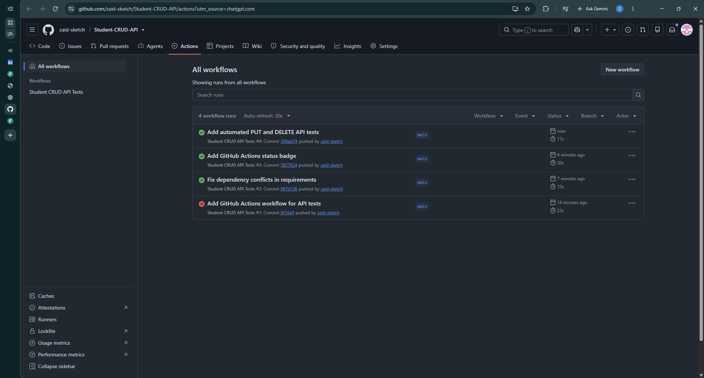
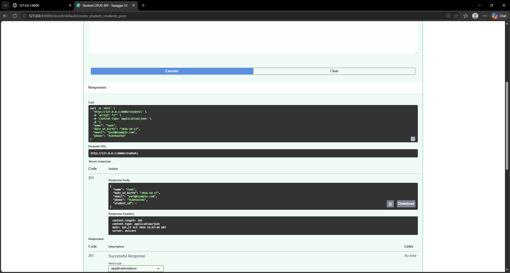
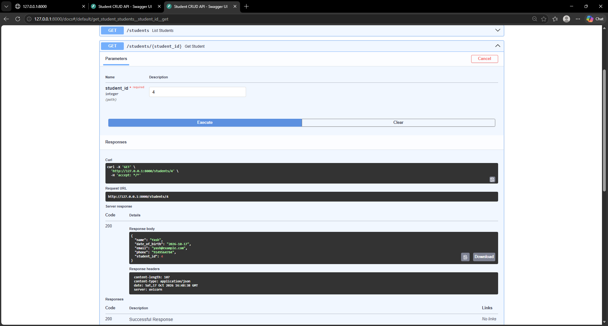

[](https://github.com/zaid-sketch/Student-CRUD-API/actions/workflows/tests.yml)

\# Student CRUD API


A RESTful API built using \*\*Python, FastAPI, Pydantic, and SQLite\*\* to manage student records.


\## Features


\- Create new student records

\- Retrieve all students

\- Search students by name

\- Retrieve student details by ID

\- Update existing student records

\- Delete student records

\- Validate email addresses, phone numbers, names, and dates of birth

\- Automatically generate API documentation using Swagger UI


\## Tech Stack


\- \*\*Backend:\*\* Python, FastAPI

\- \*\*Database:\*\* SQLite

\- \*\*Validation:\*\* Pydantic

\- \*\*API Documentation:\*\* Swagger UI

\- \*\*Server:\*\* Uvicorn


\## API Endpoints


| Method | Endpoint | Description |

|---|---|---|

| POST | `/students` | Create a student |

| GET | `/students` | Retrieve all students |

| GET | `/students?search=Amit` | Search by name |

| GET | `/students/{student\_id}` | Retrieve a student by ID |

| PUT | `/students/{student\_id}` | Update student details |

| DELETE | `/students/{student\_id}` | Delete a student |


\## Student Data Format


```json

{

&#x20; "name": "Amit Kumar",

&#x20; "date\_of\_birth": "2003-08-20",

&#x20; "email": "amit@example.com",

&#x20; "phone": "9876543210"

}

```


At least one contact method (email or phone) is required.


\## Installation


\*\*1. Clone the repository\*\*


```bash

git clone <https://github.com/zaid-sketch/Student-CRUD-API>

cd student-crud

```


\*\*2. Create a virtual environment\*\*


```bash

python -m venv venv

```


\*\*3. Activate the environment (Windows)\*\*


```cmd

venv\\Scripts\\activate

```


\*\*4. Install dependencies\*\*


```bash

pip install -r requirements.txt

```


\*\*5. Start the server\*\*


```bash

uvicorn main:app --reload

```


\*\*6. Open API documentation\*\*


http://127.0.0.1:8000/docs


\## Validation Rules


\- Student name cannot be empty or contain only spaces.

\- Date of birth cannot be in the future.

\- Email must have a valid format.

\- Phone number must contain exactly 10 digits when provided.

\- At least one contact method must be provided.


\## HTTP Status Codes


| Code | Meaning |

|---|---|

| 200 | Successful request |

| 201 | Student created |

| 404 | Student not found |

| 422 | Invalid input data |


\## Database


The application uses SQLite to store student records locally in `students.db`.


The database file is excluded from Git version control.


## Project Screenshots

### 1. GitHub Actions - CI Pipeline
Automated API tests executed successfully using GitHub Actions.



### 2. Create Student - POST API
Successfully created a student record with HTTP 201 Created.



### 3. Retrieve Student - GET API
Successfully retrieved a student record using its ID with HTTP 200 OK.




\## Author


Zaid Khan


B.Tech Computer Science \& Engineering

